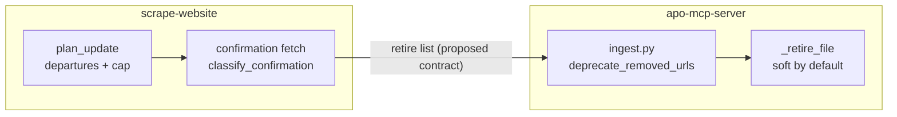

# Deletion, side by side

What `apo-mcp-server` does today when a page disappears, and what PR #10's rules propose. The left column is code that
runs; the right column is reference code that does not run yet.

Links: `apo-mcp-server` at `37e6bfc` (origin/main on 2026-10-16), `scrape-website` at `a70def7` (PR #10 pushed head).

| Question | Today (`apo-mcp-server`) | Proposed (PR #10 rules) | Gap |
| --- | --- | --- | --- |
| What marks a page as gone? | Its URL is not among the `.md` files on disk for this run: [`active_urls`](https://github.com/Harvard-ATG/apo-mcp-server/blob/37e6bfce3ee320f882b31a9738e8815048811bf9/ingest.py#L314) | In the last sitemap snapshot and absent now, R15: [`plan_update`](https://github.com/Harvard-ATG/scrape-website/blob/a70def7326f47b25d0325744dff4e7c126870347/aidocs/feature/scraper-update-mode/rules/rules.py#L167) | Different evidence. Disk presence also drops pages that returned non-200 ([`http_status != 200` skip](https://github.com/Harvard-ATG/apo-mcp-server/blob/37e6bfce3ee320f882b31a9738e8815048811bf9/ingest.py#L343)) |
| Is there a size guard? | None in [`deprecate_removed_urls`](https://github.com/Harvard-ATG/apo-mcp-server/blob/37e6bfce3ee320f882b31a9738e8815048811bf9/ingest.py#L71) | Hold all removals if more than 30% depart, R15: `removal_blocked` | Missing. A partial crawl that finds half the site retires the other half |
| Is the gone page checked? | No fetch; absence is enough | Fetch it; only 404 or 410 retires, R16: [`classify_confirmation`](https://github.com/Harvard-ATG/scrape-website/blob/a70def7326f47b25d0325744dff4e7c126870347/aidocs/feature/scraper-update-mode/rules/rules.py#L260) | Missing |
| Moved hosts | Not handled. Once the old hostname is replaced in `sites.toml` it is no longer processed, so its records are neither refreshed nor retired (not verified in a run) | Sitemap lists another host: block the host, R12: [`host_moved`](https://github.com/Harvard-ATG/scrape-website/blob/a70def7326f47b25d0325744dff4e7c126870347/aidocs/feature/scraper-update-mode/rules/rules.py#L273) | Missing; four hosts moved in the Harvard reorganization |
| Failed or partial scrape | Scrape failure stops the pipeline before ingest ([`scrape_and_ingest.py` L289](https://github.com/Harvard-ATG/apo-mcp-server/blob/37e6bfce3ee320f882b31a9738e8815048811bf9/scrape_and_ingest.py#L289)); a capped or incomplete run is gated by the scraper manifest | Retire only after a complete, uncapped run, R17 (policy) | Partly covered; the gate lives in the scraper, not in ingest |
| What does retire do? | Flips `source_status` to `removed`; hard delete only with `VECTOR_STORE_HARD_DELETE_ENABLED`: [`_retire_file`](https://github.com/Harvard-ATG/apo-mcp-server/blob/37e6bfce3ee320f882b31a9738e8815048811bf9/ingest.py#L42) | Same mechanism, fed by confirmed departures | Reuse as is |
| Fresh versus normal | `--fresh` clears local data then re-crawls ([L268](https://github.com/Harvard-ATG/apo-mcp-server/blob/37e6bfce3ee320f882b31a9738e8815048811bf9/scrape_and_ingest.py#L268)); normal pulls the last run from S3 ([L276](https://github.com/Harvard-ATG/apo-mcp-server/blob/37e6bfce3ee320f882b31a9738e8815048811bf9/scrape_and_ingest.py#L276)) and only adds | Update run reads dates and replaces changed pages | Normal runs never refresh a changed page and never retire |

## Today

```python
# ingest.py (apo-mcp-server), deprecate_removed_urls
stale = session.execute(select(WebContentFile).where(
    WebContentFile.hostname == hostname,
    WebContentFile.url.not_in(active_urls),      # not on disk this run
    WebContentFile.deleted == False,
    WebContentFile.source_status == "current",
))
for record in stale:
    _retire_file(record.file_id, "removed")      # soft unless hard-delete flag is on
```

## Proposed

```python
# rules.py (PR #10), plan_update: departures
gone = sorted(set(prev) - set(current))          # in last snapshot, not in this one
if prev and len(gone) / len(prev) > departure_cap:   # 0.30
    plan.removal_blocked = f"departure_cap:{len(gone)}/{len(prev)}"
else:
    plan.departures = gone                       # then classify_confirmation decides
```

## Where each piece would go



The contract between the two repos (a file in the manifest or S3 listing confirmed retirements) is an open question: see
[OPEN_QUESTIONS.md](OPEN_QUESTIONS.md).

## Findings for the review

1. `deprecate_removed_urls` has no cap and no confirmation. R15 and R16 exist only in the reference code.
2. `active_urls` is built from files on disk, so a page that returned 403 or 5xx during the crawl looks removed.
3. Nothing in PR #10 changes `ingest.py`; this repo cannot close the gap alone.
