# Schedules: daily, weekly, monthly

Status: **proposed**. Update mode is not wired into the scraper, so none of the new schedules can be created yet. This page
shows what exists in `atg-ops-appserver` today and what the three runs would look like there.

Source for "today": [`terraform/modules/apps/apo-mcp/main.tf`](https://github.com/Harvard-ATG/atg-ops-appserver/blob/24c065d7f356b6fe5facd79369871ebfc391a984/terraform/modules/apps/apo-mcp/main.tf)
at `24c065d` (origin/main on 2026-10-16).

## Today (Terraform, `apo-mcp` module)

| Schedule resource | When (America/New_York) | State | Task command |
| --- | --- | --- | --- |
| [`scrape_and_ingest`](https://github.com/Harvard-ATG/atg-ops-appserver/blob/24c065d7f356b6fe5facd79369871ebfc391a984/terraform/modules/apps/apo-mcp/main.tf#L203) | daily 05:00 (`cron(0 5 * * ? *)`) | **DISABLED**, hard-coded | `scrape_and_ingest.py --all --mode full --workers 8 --scrape-timeout 21600 --ingest-timeout 21600` |
| [`file_ingest`](https://github.com/Harvard-ATG/atg-ops-appserver/blob/24c065d7f356b6fe5facd79369871ebfc391a984/terraform/modules/apps/apo-mcp/main.tf#L245) | daily 07:30 (`cron(30 7 * * ? *)`) | `var.file_ingest_schedule_enabled`, default off | `modify_file.py --add --s3 ... --max-age 4h` (FAS catalog PDF) |
| config sync rule | daily 10:30 UTC (6:30 EDT) | `var.config_sync_schedule_enabled`, default off | `POST /config/sync` |

All schedules start an ECS Fargate task in cluster `atg-<env>-default` (qa uses the prod cluster) from the family
`atg-apo-mcp-<env>-task-definition`, with CPU 2048 and memory 8192 for scrape runs (`scrape_task_cpu`, `scrape_task_memory`).
Manual runs: `apps/apo-mcp/run_scrape.py [dev|prod|qa] [--all | --hostname H] [--mode scrape|ingest|full] [--fresh]`.
Progress: Splunk index `soc-isites`, source `atg-apo-mcp`.

Today the only scrape is "full", and it is switched off in Terraform; refreshes are run by hand with `run_scrape.py`.

## Proposed

```mermaid
gantt
  dateFormat  HH:mm
  axisFormat  %H:%M
  title A normal weekday (America/New_York)
  section Daily
  Update run (sitemap plan, ~50 pages)   :05:00, 30m
  Catalog file ingest (existing)         :07:30, 20m
  section Weekly (Sunday)
  Backfill slice + departure confirm     :02:00, 90m
```



| Run | Cron (Scheduler, ET) | What it does | Rules | Size |
| --- | --- | --- | --- | --- |
| **Daily** | `cron(0 5 * * ? *)` | Update run for all planned hosts: read sitemaps, fetch new and changed pages, ingest. No retiring | R1 to R14, R20 | about 50 pages a day, 341 a week (6 to 10 minutes a week, local timing) |
| **Weekly** | `cron(0 2 ? * SUN *)` | Backfill slice (capped), confirmation fetches for departures, retire confirmed pages after a complete run, write the `validate_hosts.py` report | R15, R16, R17, R20 | first run 4,339 pages, then a cap of a few thousand of the 18,205 never-captured pages until empty |
| **Monthly** | `cron(0 1 ? * SAT#1 *)` | Full re-scrape (`--fresh`) as the backstop for silent edits, listing pages and pages in no sitemap, then retire | R19 | 56,992 in-scope pages, about 17 to 27 hours (local timing) |

### Terraform shape (not applied)

Each run is one more `aws_scheduler_schedule` next to the existing two, same IAM role, cluster, subnets and task definition.
`--mode update` and `--backfill` are placeholders: neither flag exists.

```hcl
resource "aws_scheduler_schedule" "scrape_update_daily" {
  name       = "atg-${local.app_name}-${local.env}-scrape-update-daily"
  group_name = "default"
  state      = var.scrape_update_schedule_enabled ? "ENABLED" : "DISABLED"

  schedule_expression          = "cron(0 5 * * ? *)"
  schedule_expression_timezone = "America/New_York"
  flexible_time_window { mode = "OFF" }

  target {
    arn      = "arn:aws:scheduler:::aws-sdk:ecs:runTask"
    role_arn = aws_iam_role.eventbridge_scheduler_role.arn
    input = jsonencode({
      # same Cluster, TaskDefinition, LaunchType, NetworkConfiguration as scrape_and_ingest
      StartedBy = "scheduler-scrape-update-daily"
      Overrides = { ContainerOverrides = [{
        Name    = local.app_name
        Command = ["uv", "run", "python", "scrape_and_ingest.py", "--all", "--mode", "update", "--workers", "8"]
      }] }
    })
  }
}
# weekly:  cron(0 2 ? * SUN *)   Command adds "--backfill-cap", "2000", "--confirm-departures"
# monthly: cron(0 1 ? * SAT#1 *) Command is today's "--mode full --fresh" with longer timeouts
```

### What it looks like in AWS

| Where | What you see |
| --- | --- |
| EventBridge, Scheduler, default group | `atg-apo-mcp-<env>-scrape-update-daily`, `...-weekly`, `...-monthly`, plus the existing `scrape-and-ingest` and `file-ingest` |
| ECS, cluster `atg-<env>-default`, tasks | one Fargate task per run, `StartedBy` = `scheduler-scrape-update-<cadence>` |
| Splunk | index `soc-isites`, source `atg-apo-mcp`, per-host progress lines |
| S3 scrape bucket | per-host `data/` mirror updated each run (delete-then-upload) |

## Interactions to settle before enabling

1. The monthly full run lasts 17 to 27 hours. It overlaps the Sunday weekly run and the next daily run. Options: skip the
   weekly and daily runs on that weekend, or shard the monthly run by host group (see [OPEN_QUESTIONS.md](OPEN_QUESTIONS.md)).
2. Per-host scrape timeout in the existing schedule is 21,600 s (6 h); the default in `run_scrape.py` is 1,800 s.
3. Ingest takes a per-host `fcntl.flock` ([`ingest.py` L260 to 282](https://github.com/Harvard-ATG/apo-mcp-server/blob/37e6bfce3ee320f882b31a9738e8815048811bf9/ingest.py#L260)), but the code says it is same-machine only. Two separate Fargate tasks (a daily run overlapping the monthly run) do not share it, so overlap must be prevented by scheduling, not by the lock.
4. The 07:30 catalog ingest and 06:30 config sync are separate tasks; the daily update should finish before them or not matter to them.
5. Cost and rate limits: Akamai Bot Manager forced the three-tier fetch; the monthly full run is the heaviest outward-facing load.
