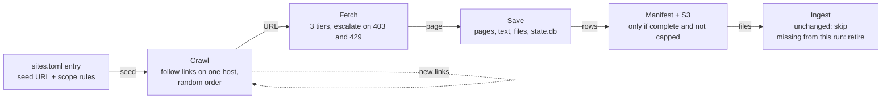
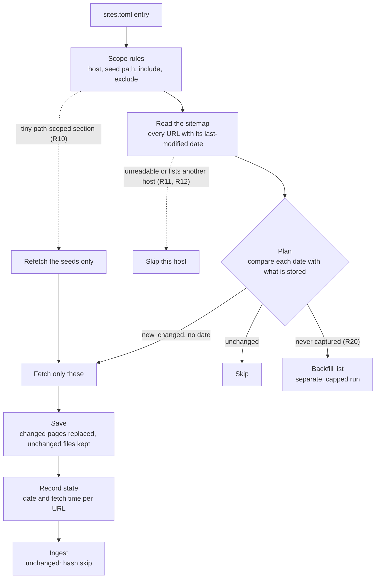
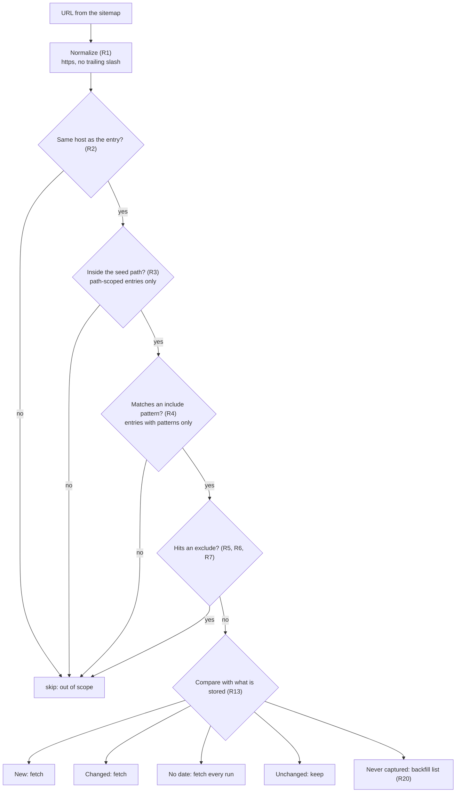
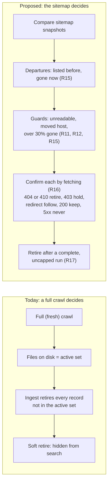

# Scrape and update: how it works

Companion to `RULES.md`. These diagrams render on GitHub. Solid boxes exist in the scraper today. Anything labelled
proposed is reference code and tests in this folder, not wired into the scraper yet.

## 1. Today: one scrape

Two ways to run it:

| Run | What it does |
| --- | --- |
| `--fresh` | Clears the host's local data, re-crawls everything, then ingest retires whatever the crawl did not reach |
| Normal | Pulls the last run from S3, skips URLs already visited, adds new pages only; changed pages stay stale; nothing is retired |

Where it hurts: crawl order is random (the same settings saved 45 to 136 pages on one site), nothing refreshes a single
changed page, and "removed" means "the crawl did not reach it" with no check on how many pages that is.

## 2. Proposed: an update run

## 3. What happens to one URL

## 4. Deleting a page

A page the crawl never reached is retired today even though it still exists. Under the proposed path only pages that were
listed and then vanished are candidates, and a fetch must agree. Pages that were never in a sitemap are covered by a
monthly full refresh (R19).

## What is in this PR

| Piece | Where it sits | Status |
| --- | --- | --- |
| 429 escalation (2 commits) | Fetch | In the scraper |
| PR #4: https canonicalization, search and `.ics` excludes | Normalize, scope | In the scraper |
| PR #7: crawl-generation columns, `_should_fetch`, manifest guard | Save, manifest | In the scraper; fetch behavior unchanged |
| PR #8: tiered sitemap discovery, cadence tooling | Read the sitemap | Discovery in the scraper; cadence is analysis |
| This folder: taxonomy, `rules.py`, tests, `validate_hosts.py` | Scope, plan, departures | Reference code and tests only |

Not built yet: the update flag itself; a stored last-modified date and saved sitemap snapshot per run; the departures and
confirmation-fetch step; the backfill run; scheduling the monthly full refresh.
