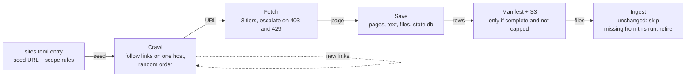
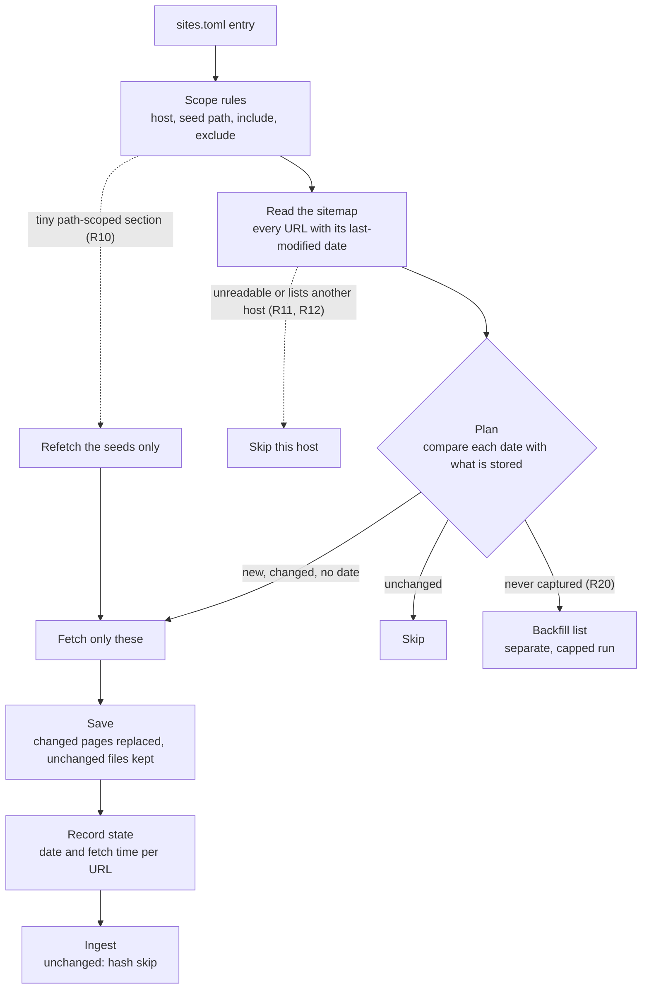
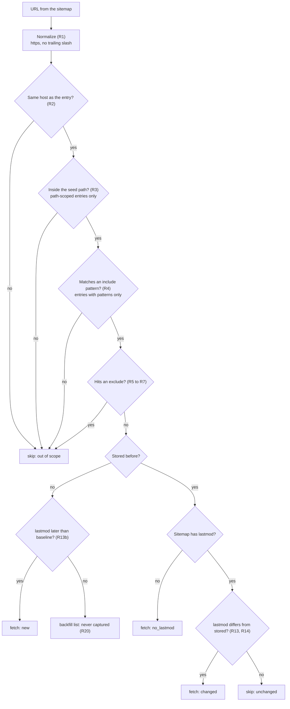
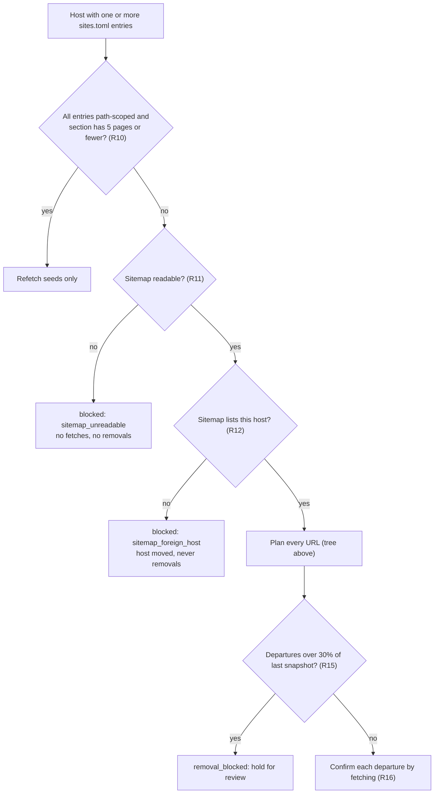
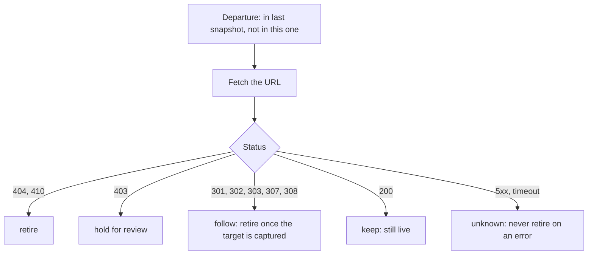

# Update mode: keeping scraped pages current

Status: **proposed**. PR #10 adds the rules, a tested reference implementation and a validation script. None of it is called by the
scraper yet; there is no `--update` flag. Anything below marked *proposed* is reference code in
`aidocs/feature/scraper-update-mode/rules/`, not scraper behavior.

Code links point at commit `a70def7` (the last pushed commit of PR #10). Rules are R1 to R20 in
[RULES.md](../aidocs/feature/scraper-update-mode/rules/RULES.md).

- [What problem this solves](#what-problem-this-solves)
- [How a scrape works today](#how-a-scrape-works-today)
- [How an update run works (proposed)](#how-an-update-run-works-proposed)
- [Decision tree: what happens to one URL](#decision-tree-what-happens-to-one-url)
- [Decision tree: what happens to a host](#decision-tree-what-happens-to-a-host)
- [Deleting pages](#deleting-pages)
- [Sitemap kinds](#sitemap-kinds)
- [Running the tests and the report](#running-the-tests-and-the-report)
- [What is not built](#what-is-not-built)
- [Updating the diagrams](#updating-the-diagrams)

## What problem this solves

Today a refresh is a re-crawl: random link order, every page fetched again, and "removed" means "the crawl did not reach it".
Update mode reads each site's XML sitemap, compares each page's `lastmod` with what is stored, and fetches only what changed.
A full re-scrape stays as the monthly backstop (R19).

Measured on 2026-10-15 over the 71 hosts the report can plan (from `report/summary.json`):

| Run | Pages | Time (local logs, not AWS) |
| --- | --- | --- |
| Full re-crawl | 56,992 | about 17 to 27 hours |
| Update, first run | 4,339 | about 1.3 to 2 hours |
| Update, each week | 341 | about 6 to 10 minutes |

18,205 never-captured pages stay out of normal runs (R20) and wait for a separate, capped backfill.

## How a scrape works today

<a id="step-today"></a>



| Stage | Code |
| --- | --- |
| Default excludes | [`_DEFAULT_EXCLUDE_PATTERNS`](https://github.com/Harvard-ATG/scrape-website/blob/a70def7326f47b25d0325744dff4e7c126870347/scrape_website/scraper.py#L84) |
| Scope helpers | [`_url_excluded`](https://github.com/Harvard-ATG/scrape-website/blob/a70def7326f47b25d0325744dff4e7c126870347/scrape_website/scraper.py#L192), [`_url_within_path_prefix`](https://github.com/Harvard-ATG/scrape-website/blob/a70def7326f47b25d0325744dff4e7c126870347/scrape_website/scraper.py#L203) |
| Sitemap discovery (URLs only, no dates) | [`_fetch_sitemap_urls`](https://github.com/Harvard-ATG/scrape-website/blob/a70def7326f47b25d0325744dff4e7c126870347/scrape_website/scraper.py#L228) |
| State database | [`URLStore`](https://github.com/Harvard-ATG/scrape-website/blob/a70def7326f47b25d0325744dff4e7c126870347/scrape_website/scraper.py#L536) |
| Where update plugs in | [`_should_fetch`](https://github.com/Harvard-ATG/scrape-website/blob/a70def7326f47b25d0325744dff4e7c126870347/scrape_website/scraper.py#L360) |
| Crawl loop | [`crawl`](https://github.com/Harvard-ATG/scrape-website/blob/a70def7326f47b25d0325744dff4e7c126870347/scrape_website/scraper.py#L1397) |

## How an update run works (proposed)

<a id="step-update"></a>



The planner is [`plan_update`](https://github.com/Harvard-ATG/scrape-website/blob/a70def7326f47b25d0325744dff4e7c126870347/aidocs/feature/scraper-update-mode/rules/rules.py#L167).
It returns a `Plan` with `fetch` (url to reason), `skip`, `backfill`, `departures`, `removal_blocked`, `blocked` and
`out_of_scope`.

## Decision tree: what happens to one URL

<a id="step-url"></a>

Implemented by [`evaluate`](https://github.com/Harvard-ATG/scrape-website/blob/a70def7326f47b25d0325744dff4e7c126870347/aidocs/feature/scraper-update-mode/rules/rules.py#L119) (scope) and the loop in `plan_update` (dates).



## Decision tree: what happens to a host

<a id="step-host"></a>



## Deleting pages

<a id="step-delete"></a>

A page is a departure when it was in the last sitemap snapshot and is not in this one (R15). A departure is not deleted on
that evidence alone; the planner proposes it, a confirmation fetch decides ([`classify_confirmation`](https://github.com/Harvard-ATG/scrape-website/blob/a70def7326f47b25d0325744dff4e7c126870347/aidocs/feature/scraper-update-mode/rules/rules.py#L260)):



Retiring only happens after a complete, uncapped run of the host (R17, policy, not coded). The side-by-side with what
`apo-mcp-server` does today is in
[DELETION_SIDE_BY_SIDE.md](../aidocs/feature/scraper-update-mode/review/DELETION_SIDE_BY_SIDE.md).

## Sitemap kinds

<a id="step-sitemaps"></a>

| Kind | Where | Hosts | Has dates |
| --- | --- | --- | --- |
| XML sitemap | `/sitemap.xml` (often an index) | 79 of 83 | Yes: `lastmod` per URL |
| Markdown sitemap | `/sitemap-llm` | 52 (Drupal 10) | No: title and link only; also lists files |
| Per-page `.md` copy | page URL plus `.md` | the same 52 | No |

What each carries (checked on saved `haa` and `celtic` samples, 2026-10-21):

| | XML sitemap | Markdown sitemap (`/sitemap-llm`) |
| --- | --- | --- |
| Per entry | `loc`, `lastmod`, usually `priority`, rarely `changefreq` | title and link |
| Pages | listed with `lastmod` | listed, no date in the list; the page `.md` copy has a written date only on news, events and blog pages (publication or event date, day only) |
| Files | landing pages (`/resource/...`) listed with `lastmod`: all 10,775 in the 2026-10-15 snapshot have one | listed (24% of entries), each linking to a card |
| File card body | not in the XML | size, format, date (MM/DD/YYYY), download path |

Checked 2026-10-21 on 20 cards: 19 had a date, and 14 of those equal the XML `lastmod` date of the same landing page. The other 5 have a card date years older than an XML `lastmod` moved by a bulk re-save, so the card date looks like the file's own date and the XML also moves on re-saves. The card date is date only. The card's HTTP `Last-Modified` is the render time and is not usable. See `aidocs/feature/scraper-update-mode/review/SITEMAP_LLM_VS_XML.md`.
Our parser (`sitemap_parse.py`) keeps `loc` and `lastmod`; the scraper's `_fetch_sitemap_urls` keeps neither.

Only the XML sitemap can say what changed. Pages in no sitemap, and silent edits, rely on the monthly full refresh (R19).

## Running the tests and the report

<a id="step-tests"></a>

```bash
cd aidocs/feature/scraper-update-mode/rules
../../../../.venv/bin/python -m pytest tests -q        # rules, plan, per-host invariants
../../../../.venv/bin/python validate_hosts.py         # writes report/hosts.csv and report/summary.json
cd ../../../.. && .venv/bin/python -m pytest tests -q  # scraper tests (47)
```

Results recorded on 2026-10-16 are in
[TEST_RESULTS.md](../aidocs/feature/scraper-update-mode/review/TEST_RESULTS.md).

## What is not built

<a id="step-not-built"></a>

- The `--update` flag and any call from `scraper.py` into `rules.py` (the seam is `_should_fetch`).
- Per-URL `lastmod` and `fetched` columns in `state.db` (R13 reads them from a `state` dict today).
- Confirmation fetches and retirement in `apo-mcp-server` (R16, R17).
- The backfill runner (R20) and the monthly full refresh job (R19).
- The schedules in [SCHEDULES.md](../aidocs/feature/scraper-update-mode/review/SCHEDULES.md).
- Rules R6 and R7 (extra excludes, event pages) are off in code until adopted.

## Updating the diagrams

Diagrams here are Mermaid: edit the fenced block and GitHub redraws it, no build step. The pictures in
`aidocs/feature/scraper-update-mode/rules/overview/tour/` are generated by `build_tour_images.py` (SVG and PNG) for the code
tour. If a rule changes, update `RULES.md`, the matching tree above, and the test that covers it in the same commit.
